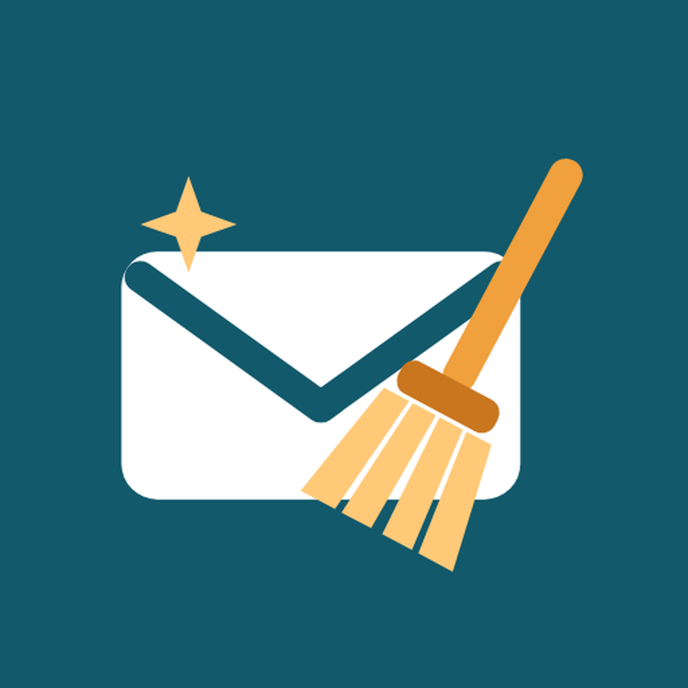

<h1 align="center">📱 Gmail Cleaner Buddy — iPhone</h1>

  

  <a href="#pt">🇧🇷 Português</a> ·
  <a href="#en">🇺🇸 English</a> ·
  <a href="#es">🇪🇸 Español</a> ·
  <a href="#fr">🇫🇷 Français</a> ·
  <a href="#it">🇮🇹 Italiano</a> ·
  <a href="#ru">🇷🇺 Русский</a> ·
  <a href="#zh">🇨🇳 中文</a>

> 🌐 https://mbastida43.github.io/gmailcleanerbuddyapp_ios/ 
> 🛠️ [`INSTRUCTIONS.md`](INSTRUCTIONS.md) 
> 🔒 https://mbastida43.github.io/gmailcleanerbuddyapp/privacy.html

---

## 🇧🇷 Português

**Descubra quem mais lota o seu Gmail**

Analise sua caixa de entrada, veja o ranking Top 10 Ofensores e mande todos os e-mails deles para a lixeira com um toque — direto do celular, sem servidor.

**Como funciona**
- **Conecte sua conta** — Login oficial do Google (OAuth2) na própria folha de login do iPhone — o app nunca vê a sua senha.
- **Analise a caixa** — O app conta com precisão quantos e-mails cada remetente enviou para você.
- **Veja o ranking** — Top 10 Ofensores: os que mais lotam sua caixa, com categoria e volume estimado.
- **Limpe com um toque** — Mande os e-mails de um remetente — ou o Top 10 inteiro — para a lixeira de uma vez.

**Privacidade em primeiro lugar**
- Login oficial do Google — o app nunca vê sua senha.
- Nenhuma credencial fica salva no aparelho — o acesso vive só na memória e some quando você fecha o app.
- Nada é apagado permanentemente — os e-mails vão para a Lixeira do Gmail, recuperável por 30 dias.
- O app não lê o conteúdo das mensagens — só o endereço do remetente é usado para montar o ranking.

**Recursos**
- **Top 10 Ofensores** — os remetentes que mais lotam sua caixa
- **Contagem exata** — de e-mails por remetente, não só uma amostra
- **Limpeza em massa** — com um toque, sem abrir e-mail por e-mail
- **Categorias automáticas** — redes sociais, compras, notícias e mais
- **7 idiomas** — Português, Inglês, Espanhol, Francês, Italiano, Russo e Chinês
- **Sem servidor** — o celular fala direto com a API do Gmail

**Instalar no iPhone**

1. **Instale o Sideloadly** — Num PC com Windows ou num Mac, instale o iTunes (do site da Apple) e o Sideloadly (sideloadly.io).
2. **Baixe o app** — Toque no botão abaixo para baixar o GmailCleanerBuddy.ipa.
3. **Conecte o iPhone** — Ligue no cabo, desbloqueie a tela e toque em Confiar.
4. **Instale** — Arraste o .ipa para o Sideloadly, digite o seu Apple ID e clique em Start.
5. **Confie no app** — No iPhone: Ajustes → Geral → VPN e Gerenciamento de Dispositivo → seu Apple ID → Confiar.

**[⬇️ Baixar o .ipa](https://github.com/mbastida43/gmailcleanerbuddyapp_ios/releases/latest/download/GmailCleanerBuddy.ipa)**

> Funciona no iOS 15 ou mais novo (iPhone 6s, 7 e posteriores). Com Apple ID grátis, reinstale a cada 7 dias. Até o Google concluir a verificação do app, só contas de teste conseguem entrar. Em breve na App Store.

---

## 🇺🇸 English

**Discover who's flooding your Gmail**

Scan your inbox, see the Top 10 Offenders ranking, and move all of their emails to the trash with one tap — right from your phone, no server required.

**How it works**
- **Connect your account** — Official Google sign-in (OAuth2) in the iPhone's own sign-in sheet — the app never sees your password.
- **Scan your inbox** — The app counts exactly how many emails each sender sent you.
- **See the ranking** — Top 10 Offenders — the senders flooding your inbox, with category and estimated size.
- **Clean with one tap** — Send a sender’s emails — or the whole Top 10 — to the trash at once.

**Privacy first**
- Official Google sign-in — the app never sees your password.
- No credentials stored on the device — the access lives only in memory and is gone when you close the app.
- Nothing is deleted forever — emails go to Gmail's own Trash, recoverable for 30 days.
- The app doesn't read message content — only the sender address is used to build the ranking.

**Features**
- **Top 10 Offenders** — the senders flooding your inbox
- **Exact count** — of emails per sender, not just a sample
- **Bulk cleanup** — with one tap, no opening emails one by one
- **Automatic categories** — social media, shopping, news and more
- **7 languages** — Portuguese, English, Spanish, French, Italian, Russian and Chinese
- **No server** — your phone talks directly to the Gmail API

**Install on iPhone**

1. **Get Sideloadly** — On a Windows PC or a Mac, install iTunes (from Apple's website) and Sideloadly (sideloadly.io).
2. **Download the app** — Tap the button below to download GmailCleanerBuddy.ipa.
3. **Connect the iPhone** — Plug it in with a cable, unlock it and tap Trust.
4. **Install** — Drag the .ipa into Sideloadly, enter your Apple ID and click Start.
5. **Trust the app** — On the iPhone: Settings → General → VPN & Device Management → your Apple ID → Trust.

**[⬇️ Download the .ipa](https://github.com/mbastida43/gmailcleanerbuddyapp_ios/releases/latest/download/GmailCleanerBuddy.ipa)**

> Works on iOS 15 or later (iPhone 6s, 7 and newer). With a free Apple ID, reinstall every 7 days. Until Google finishes verifying the app, only test accounts can sign in. App Store release coming soon.

---

## 🇪🇸 Español

**Descubre quién llena más tu Gmail**

Analiza tu bandeja de entrada, mira el ranking Top 10 Infractores y envía todos sus correos a la papelera con un toque — directo desde tu celular, sin servidor.

**Cómo funciona**
- **Conecta tu cuenta** — Inicio de sesión oficial de Google (OAuth2) en la propia hoja de inicio de sesión del iPhone: la app nunca ve tu contraseña.
- **Analiza tu bandeja** — La app cuenta con precisión cuántos correos te envió cada remitente.
- **Mira el ranking** — Top 10 Infractores: los que más llenan tu bandeja, con categoría y volumen estimado.
- **Limpia con un toque** — Envía los correos de un remitente — o todo el Top 10 — a la papelera de una vez.

**La privacidad primero**
- Inicio de sesión oficial de Google — la app nunca ve tu contraseña.
- No se guarda ninguna credencial en el dispositivo: el acceso vive solo en memoria y desaparece al cerrar la app.
- Nada se elimina para siempre — los correos van a la Papelera de Gmail, recuperables por 30 días.
- La app no lee el contenido de los mensajes — solo se usa la dirección del remitente para armar el ranking.

**Funciones**
- **Top 10 Infractores** — los remitentes que más llenan tu bandeja
- **Conteo exacto** — de correos por remitente, no solo una muestra
- **Limpieza masiva** — con un toque, sin abrir correo por correo
- **Categorías automáticas** — redes sociales, compras, noticias y más
- **7 idiomas** — Portugués, Inglés, Español, Francés, Italiano, Ruso y Chino
- **Sin servidor** — el celular habla directo con la API de Gmail

**Instalar en iPhone**

1. **Instala Sideloadly** — En un PC con Windows o en un Mac, instala iTunes (desde el sitio de Apple) y Sideloadly (sideloadly.io).
2. **Descarga la app** — Toca el botón de abajo para descargar GmailCleanerBuddy.ipa.
3. **Conecta el iPhone** — Conéctalo con un cable, desbloquéalo y toca Confiar.
4. **Instala** — Arrastra el .ipa a Sideloadly, escribe tu Apple ID y haz clic en Start.
5. **Confía en la app** — En el iPhone: Ajustes → General → VPN y gestión de dispositivos → tu Apple ID → Confiar.

**[⬇️ Descargar el .ipa](https://github.com/mbastida43/gmailcleanerbuddyapp_ios/releases/latest/download/GmailCleanerBuddy.ipa)**

> Funciona en iOS 15 o posterior (iPhone 6s, 7 y más nuevos). Con un Apple ID gratuito, reinstala cada 7 días. Hasta que Google termine de verificar la app, solo las cuentas de prueba pueden iniciar sesión. Pronto en la App Store.

---

## 🇫🇷 Français

**Découvrez qui encombre le plus votre Gmail**

Analysez votre boîte de réception, consultez le classement Top 10 des Indésirables et déplacez tous leurs e-mails vers la corbeille en un geste — directement depuis votre téléphone, sans serveur.

**Comment ça marche**
- **Connectez votre compte** — Connexion Google officielle (OAuth2) dans la fenêtre de connexion de l’iPhone — l’app ne voit jamais votre mot de passe.
- **Analysez votre boîte** — L'app compte précisément combien d'e-mails chaque expéditeur vous a envoyés.
- **Consultez le classement** — Top 10 des Indésirables : les expéditeurs qui encombrent votre boîte, avec catégorie et volume estimé.
- **Nettoyez en un geste** — Envoyez les e-mails d'un expéditeur — ou tout le Top 10 — à la corbeille d'un coup.

**Priorité à la vie privée**
- Connexion officielle Google — l'app ne voit jamais votre mot de passe.
- Aucun identifiant n’est enregistré sur l’appareil — l’accès reste uniquement en mémoire et disparaît à la fermeture de l’app.
- Rien n'est supprimé définitivement — les e-mails vont dans la Corbeille de Gmail, récupérables pendant 30 jours.
- L'app ne lit pas le contenu des messages — seule l'adresse de l'expéditeur sert à établir le classement.

**Fonctionnalités**
- **Top 10 des Indésirables** — les expéditeurs qui encombrent votre boîte
- **Comptage exact** — des e-mails par expéditeur, pas seulement un échantillon
- **Nettoyage groupé** — en un geste, sans ouvrir les e-mails un par un
- **Catégories automatiques** — réseaux sociaux, achats, actualités et plus
- **7 langues** — Portugais, Anglais, Espagnol, Français, Italien, Russe et Chinois
- **Sans serveur** — le téléphone parle directement à l'API Gmail

**Installer sur iPhone**

1. **Installez Sideloadly** — Sur un PC Windows ou un Mac, installez iTunes (depuis le site d’Apple) et Sideloadly (sideloadly.io).
2. **Téléchargez l’app** — Touchez le bouton ci-dessous pour télécharger GmailCleanerBuddy.ipa.
3. **Branchez l’iPhone** — Branchez-le avec un câble, déverrouillez-le et touchez Se fier.
4. **Installez** — Glissez le .ipa dans Sideloadly, saisissez votre identifiant Apple et cliquez sur Start.
5. **Faites confiance à l’app** — Sur l’iPhone : Réglages → Général → VPN et gestion de l’appareil → votre identifiant Apple → Se fier.

**[⬇️ Télécharger le .ipa](https://github.com/mbastida43/gmailcleanerbuddyapp_ios/releases/latest/download/GmailCleanerBuddy.ipa)**

> Fonctionne sous iOS 15 ou plus récent (iPhone 6s, 7 et suivants). Avec un identifiant Apple gratuit, réinstallez tous les 7 jours. Tant que Google n’a pas fini de vérifier l’app, seuls les comptes de test peuvent se connecter. Bientôt sur l’App Store.

---

## 🇮🇹 Italiano

**Scopri chi intasa di più il tuo Gmail**

Analizza la tua casella, guarda la classifica Top 10 Responsabili e sposta tutte le loro email nel cestino con un tocco — direttamente dal telefono, senza server.

**Come funziona**
- **Collega il tuo account** — Accesso ufficiale Google (OAuth2) nella schermata di accesso dell’iPhone — l’app non vede mai la tua password.
- **Analizza la casella** — L'app conta con precisione quante email ha inviato ciascun mittente.
- **Guarda la classifica** — Top 10 Responsabili: i mittenti che intasano di più la casella, con categoria e volume stimato.
- **Pulisci con un tocco** — Sposta le email di un mittente — o l'intera Top 10 — nel cestino in un colpo solo.

**Privacy al primo posto**
- Accesso ufficiale Google — l'app non vede mai la tua password.
- Nessuna credenziale salvata sul dispositivo — l’accesso resta solo in memoria e sparisce quando chiudi l’app.
- Niente viene cancellato per sempre — le email finiscono nel Cestino di Gmail, recuperabili per 30 giorni.
- L'app non legge il contenuto dei messaggi — solo l'indirizzo del mittente è usato per creare la classifica.

**Funzionalità**
- **Top 10 Responsabili** — i mittenti che intasano di più la casella
- **Conteggio esatto** — delle email per mittente, non solo un campione
- **Pulizia in blocco** — con un tocco, senza aprire le email una per una
- **Categorie automatiche** — social, acquisti, notizie e altro
- **7 lingue** — Portoghese, Inglese, Spagnolo, Francese, Italiano, Russo e Cinese
- **Senza server** — il telefono parla direttamente con l'API di Gmail

**Installa su iPhone**

1. **Installa Sideloadly** — Su un PC Windows o un Mac, installa iTunes (dal sito di Apple) e Sideloadly (sideloadly.io).
2. **Scarica l’app** — Tocca il pulsante qui sotto per scaricare GmailCleanerBuddy.ipa.
3. **Collega l’iPhone** — Collegalo con un cavo, sbloccalo e tocca Autorizza.
4. **Installa** — Trascina il .ipa in Sideloadly, inserisci il tuo ID Apple e fai clic su Start.
5. **Autorizza l’app** — Sull’iPhone: Impostazioni → Generali → VPN e gestione dispositivi → il tuo ID Apple → Autorizza.

**[⬇️ Scarica il .ipa](https://github.com/mbastida43/gmailcleanerbuddyapp_ios/releases/latest/download/GmailCleanerBuddy.ipa)**

> Funziona su iOS 15 o successivo (iPhone 6s, 7 e più recenti). Con un ID Apple gratuito, reinstalla ogni 7 giorni. Finché Google non completa la verifica dell’app, possono accedere solo gli account di test. Presto sull’App Store.

---

## 🇷🇺 Русский

**Узнайте, кто больше всего забивает ваш Gmail**

Проанализируйте почтовый ящик, посмотрите рейтинг Топ-10 нарушителей и переместите все их письма в корзину одним касанием — прямо с телефона, без сервера.

**Как это работает**
- **Подключите аккаунт** — Официальный вход Google (OAuth2) в системном окне входа iPhone — приложение никогда не видит ваш пароль.
- **Проанализируйте ящик** — Приложение точно подсчитывает, сколько писем отправил каждый отправитель.
- **Посмотрите рейтинг** — Топ-10 нарушителей: отправители, забивающие ваш ящик, с категорией и примерным объёмом.
- **Очистите одним касанием** — Отправьте письма одного отправителя — или весь Топ-10 — в корзину сразу.

**Приватность прежде всего**
- Официальный вход через Google — приложение никогда не видит ваш пароль.
- На устройстве не хранятся учётные данные — доступ живёт только в памяти и исчезает, когда вы закрываете приложение.
- Ничего не удаляется навсегда — письма перемещаются в Корзину Gmail, их можно восстановить в течение 30 дней.
- Приложение не читает содержимое сообщений — для рейтинга используется только адрес отправителя.

**Возможности**
- **Топ-10 нарушителей** — отправители, забивающие ваш ящик
- **Точный подсчёт** — писем по каждому отправителю, а не просто выборка
- **Массовая очистка** — одним касанием, без открытия писем по одному
- **Автоматические категории** — соцсети, покупки, новости и другое
- **7 языков** — Португальский, Английский, Испанский, Французский, Итальянский, Русский и Китайский
- **Без сервера** — телефон общается напрямую с API Gmail

**Установка на iPhone**

1. **Установите Sideloadly** — На компьютере с Windows или на Mac установите iTunes (с сайта Apple) и Sideloadly (sideloadly.io).
2. **Скачайте приложение** — Нажмите кнопку ниже, чтобы скачать GmailCleanerBuddy.ipa.
3. **Подключите iPhone** — Подключите кабелем, разблокируйте и нажмите «Доверять».
4. **Установите** — Перетащите .ipa в Sideloadly, введите свой Apple ID и нажмите Start.
5. **Доверьтесь приложению** — На iPhone: Настройки → Основные → VPN и управление устройством → ваш Apple ID → Доверять.

**[⬇️ Скачать .ipa](https://github.com/mbastida43/gmailcleanerbuddyapp_ios/releases/latest/download/GmailCleanerBuddy.ipa)**

> Работает на iOS 15 и новее (iPhone 6s, 7 и новее). С бесплатным Apple ID переустанавливайте каждые 7 дней. Пока Google не завершит проверку приложения, войти могут только тестовые аккаунты. Скоро в App Store.

---

## 🇨🇳 中文

**看看谁在塞满你的 Gmail**

分析你的收件箱，查看前 10 名骚扰发件人排行榜，一键将他们的所有邮件移至垃圾箱 —— 直接在手机上完成，无需服务器。

**工作原理**
- **连接你的账号** — 在 iPhone 自带的登录界面中使用 Google 官方登录（OAuth2）——应用永远看不到你的密码。
- **分析收件箱** — 应用精确统计每个发件人发送给你的邮件数量。
- **查看排行榜** — 前 10 名骚扰发件人，附带分类和预估容量。
- **一键清理** — 一次性将某个发件人的邮件 —— 或整个前 10 名 —— 移至垃圾箱。

**隐私优先**
- 官方 Google 登录 —— 应用绝不会看到你的密码。
- 设备上不保存任何凭据——访问权限只存在于内存中，关闭应用即消失。
- 不会永久删除任何内容 —— 邮件会移入 Gmail 自己的垃圾箱，30 天内可恢复。
- 应用不会读取邮件内容 —— 排行榜只使用发件人地址。

**功能**
- **前 10 名骚扰发件人** — 占用收件箱最多的发件人
- **精确计数** — 按发件人统计邮件数量，而不仅仅是抽样
- **批量清理** — 一键完成，无需逐封打开邮件
- **自动分类** — 社交媒体、购物、新闻等
- **支持 7 种语言** — 葡萄牙语、英语、西班牙语、法语、意大利语、俄语和中文
- **无需服务器** — 手机直接与 Gmail API 通信

**在 iPhone 上安装**

1. **安装 Sideloadly** — 在 Windows 电脑或 Mac 上安装 iTunes（从 Apple 官网下载）和 Sideloadly（sideloadly.io）。
2. **下载应用** — 点击下方按钮下载 GmailCleanerBuddy.ipa。
3. **连接 iPhone** — 用数据线连接，解锁屏幕并点击“信任”。
4. **安装** — 把 .ipa 拖到 Sideloadly 中，输入你的 Apple ID，然后点击 Start。
5. **信任应用** — 在 iPhone 上：设置 → 通用 → VPN 与设备管理 → 你的 Apple ID → 信任。

**[⬇️ 下载 .ipa](https://github.com/mbastida43/gmailcleanerbuddyapp_ios/releases/latest/download/GmailCleanerBuddy.ipa)**

> 支持 iOS 15 及以上（iPhone 6s、7 及更新机型）。使用免费 Apple ID 时，每 7 天需重新安装一次。在 Google 完成应用验证之前，只有测试账号可以登录。即将登陆 App Store。

---

## License

MIT — [LICENSE.md](LICENSE.md)
